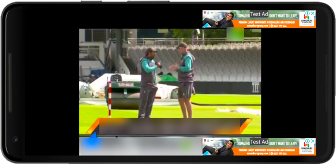
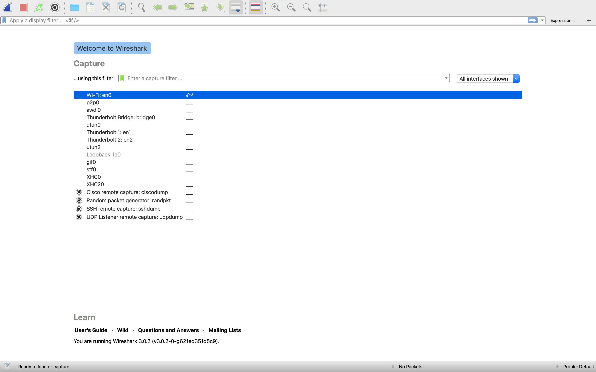
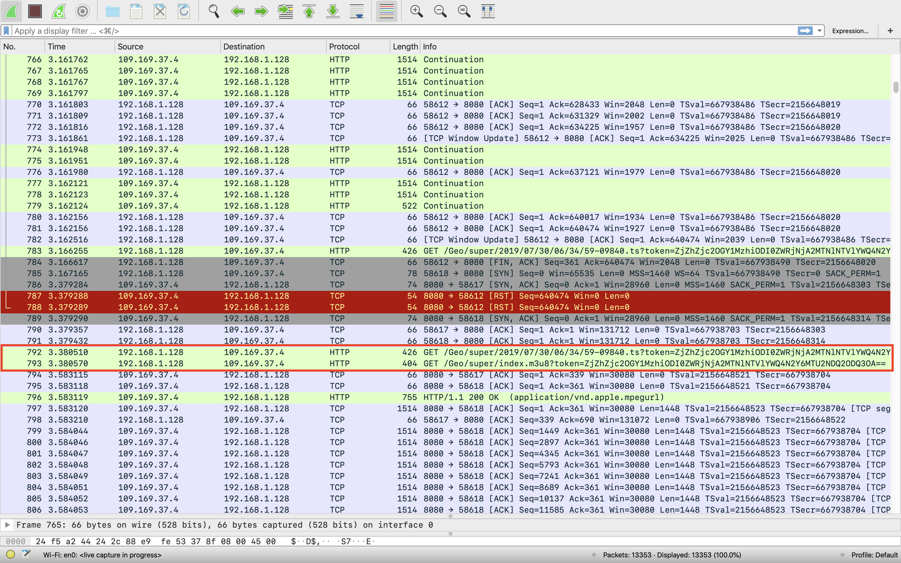
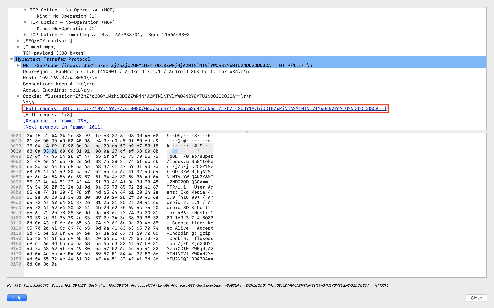
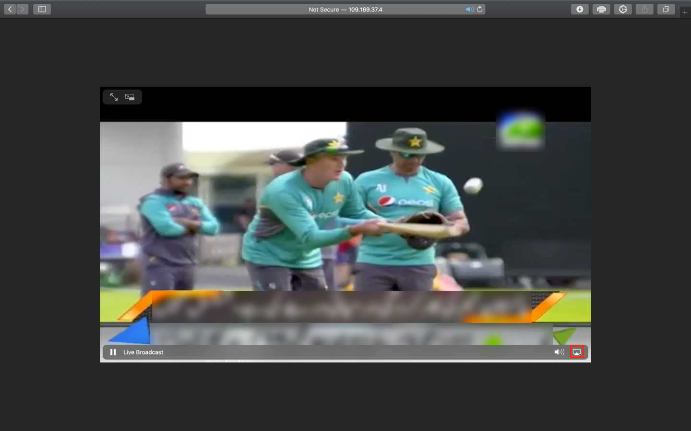
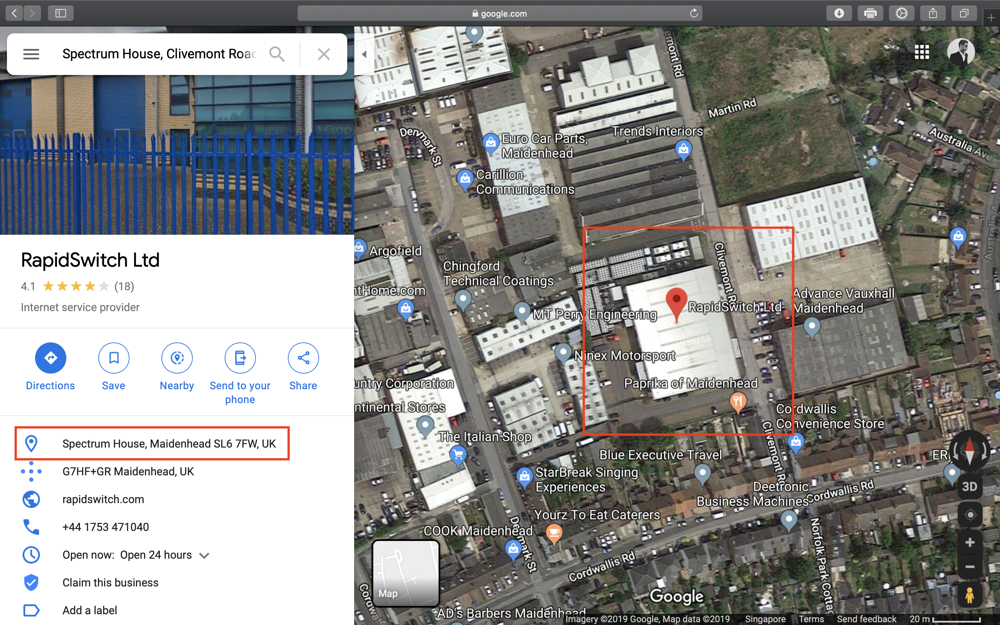

> This blog post, originally written in 2019, was migrated from my old blog site.

The ICC Cricket World Cup ended a few weeks ago, and about 2.6 billion people watched it worldwide. That makes it the most-watched cricket competition as of 2019. More and more people now watch on-demand video through mobile apps such as Netflix and YouTube, rather than on traditional TV sets with cable or fiber connections. Most of us now rely on native or web apps to watch media.

Cricket is a seasonal sport. Players almost always play high-level cricket outdoors on uncovered pitches, where rain stops play, so each country schedules its season during its driest months. Daylight hours and temperature also shape the schedule in some countries. In England, for example, winter days are often too short, dark and cold for outdoor cricket, so players move indoors after the season ends. A single year means a northern hemisphere summer season, and a pair of years with a dash means a southern hemisphere summer. In tropical regions, people can play cricket all year. The United Kingdom's season runs from mid-April to September, while Australia's starts in October and ends in February or March.

Most people follow only a few cricket teams, so a cable or fiber TV connection for a sports channel may not be worth the cost, especially for a seasonal sport. Many cricket fans have therefore moved to live streaming through mobile or web apps. Most of these apps are free, supported by ads, or available for a small subscription fee.

I found a reputable Android app with good reviews on the Google Play Store. I downloaded it to my Samsung tablet to watch the ICC Cricket World Cup, but holding a tablet and watching it for hours strained my hands and eyes. So I decided to watch the match live on my TV instead.

## Setting Up

I used an online APK downloader to get the app's APK file from the Google Play Store. I will not recommend a specific downloader, because the choice comes down to preference, and reputable ones are easy to find online. After the download, I opened Android Studio, went to `Tools > AVD Manager`, and started a Pixel 2 XL (Android 7.1.1) AVD in the emulator. Then I installed the app by dragging the APK file onto the emulator screen.


_The Pixel 2 XL Android Virtual Device (AVD) in the emulator_

I opened the app from the AVD's app menu. Like many apps that earn money from ads, it showed advertisements as soon as it launched, and banner ads filled the media player screen. To find the URL that the player used for the live broadcast, I closed my browser, turned off my VPN and started Wireshark to capture packets.

## Packet Analysis

Wireshark captures network packets in real time and shows them in a readable format. You can download it for your operating system from the [official Wireshark website](https://www.wireshark.org/#download). My Mac connects to the Internet through the `WiFi: en0` interface, which the emulator also uses to stream the broadcast.


_I capture packets from the WiFi: en0 interface on my Mac_

Before the capture, I checked that my browser was closed, my VPN was off and other running apps had quit. Then I clicked the blue shark fin in the upper-left corner of the menu to capture packets from `WiFi: en0`. I let the capture run for about 30 seconds, so Wireshark had enough traffic to analyze the packets that the interface sent and received.


_The app makes two GET requests of interest_

The app appears to use GET requests to retrieve two types of files: `.ts` and `.m3u8`. An MPEG transport stream is a standard digital container format for sending and storing audio, video and Program and System Information Protocol (PSIP) data. Its extensions include `.ts`, `.tsv` and `.tsa`, and broadcasting systems such as DVB, ATSC and IPTV use this format. The app uses Internet Protocol Television (IPTV), which sends television content over Internet Protocol (IP) networks instead of traditional terrestrial, satellite or cable systems. IPTV streams media continuously rather than requiring a download, so a player can start showing content, such as a TV channel, almost at once. This is known as streaming media.

M3U, short for MP3 URL or Moving Picture Experts Group Audio Layer 3 Uniform Resource Locator, is a multimedia playlist format with the extensions `.m3u` and `.m3u8`. A common use is a single-entry playlist that points to an Internet stream, which makes the stream easy to reach through website downloads, email or Internet radio.

M3U was first designed for audio files such as MP3, but media players now commonly use it to find both audio and video sources, including online ones. Fraunhofer developed M3U for its Winplay3 software, and other media player and software developers soon adopted the standard.

M3U8 is the Unicode version of M3U and uses UTF-8 encoded characters. M3U8 files form the basis of HTTP Live Streaming (HLS), which Apple first developed to stream video and radio to iOS devices. HLS is now widely used for adaptive streaming over HTTP, and Dynamic Adaptive Streaming over HTTP (DASH) is a separate standard that works in a similar way.

To stream the broadcast, the app retrieves a `.m3u8` playlist that points the player to the media source. It then retrieves a `.ts` file, which contains packetized elementary streams. The file includes error correction and synchronization patterns that preserve the transmission when noise or damage affects the channel.

To open the `.m3u8` file in a browser, we need its URL. Wireshark has already captured and analyzed the request, so we can get the URL from the packet.


_The full request URL from which we can stream the live broadcast_

The Hypertext Transfer Protocol section shows the full request URL for the `.m3u8` file. I pasted it into Safari's search box, and the live broadcast started at once. I then clicked the AirPlay button in Safari's default video player, which sent the stream to my TV, where I could finally watch the match!



## OSINT

I also wanted to know who provided the app's back end. An independent developer would find it nearly impossible to build and manage server infrastructure for hundreds of thousands of simultaneous viewers, so I ran a `whois` lookup on the server's IP address.

```
[TRUNCATED]
inetnum:        109.169.0.0 - 109.169.95.255
netname:        UK-RAPIDSWITCH-20091102
country:        GB
org:            ORG-RL20-RIPE
admin-c:        AR6363-RIPE
tech-c:         AR6363-RIPE
status:         ALLOCATED PA
mnt-by:         RIPE-NCC-HM-MNT
mnt-by:         RAPIDSWITCH-MNT
mnt-routes:     RAPIDSWITCH-MNT
created:        2010-02-11T09:11:40Z
last-modified:  2017-03-24T16:04:24Z
source:         RIPE # Filtered

organisation:   ORG-RL20-RIPE
org-name:       IOMART HOSTING LIMITED
org-type:       LIR
address:        Spectrum House, Clivemont Road
address:        SL6 7FW
address:        Maidenhead
address:        UNITED KINGDOM
phone:          +441753471040
fax-no:         +441753471049
admin-c:        RC6613-RIPE
admin-c:        DB16530-RIPE
admin-c:        RM1358-RIPE
admin-c:        SMC74-RIPE
admin-c:        AR6363-RIPE
mnt-ref:        RAPIDSWITCH-MNT
mnt-ref:        RIPE-NCC-HM-MNT
mnt-by:         RIPE-NCC-HM-MNT
mnt-by:         RAPIDSWITCH-MNT
abuse-c:        AR12896-RIPE
created:        2005-09-26T12:37:33Z
last-modified:  2018-12-11T14:48:04Z
source:         RIPE # Filtered

person:         Abuse Robot
address:        iomart Hosting Ltd t/a RapidSwitch
address:        Spectrum House
address:        Clivemont Road
address:        Maidenhead
address:        SL6 7FW
phone:          +44 (0)1753 471 040
remarks:        ******************************************************
remarks:        * ABUSE REPORTS                                      *
remarks:        * https://myservers.rapidswitch.com/reportabuse.aspx *
remarks:        ******************************************************
nic-hdl:        AR6363-RIPE
mnt-by:         RAPIDSWITCH-MNT
created:        2007-02-11T09:38:19Z
last-modified:  2017-10-30T21:53:52Z
source:         RIPE # Filtered
[TRUNCATED]
```

iomart Hosting Limited, which trades as RapidSwitch, owns the server that broadcasts the stream, and Google Maps confirmed that its data center is at Spectrum House, Maidenhead SL6 7FW, UK.


_RapidSwitch's data center in Spectrum House, United Kingdom_

Disassembling the app's APK file could tell us more about the frameworks and technologies that it uses to stream the broadcast. I will stop here, because I need to watch the rest of the match. Goodbye!
