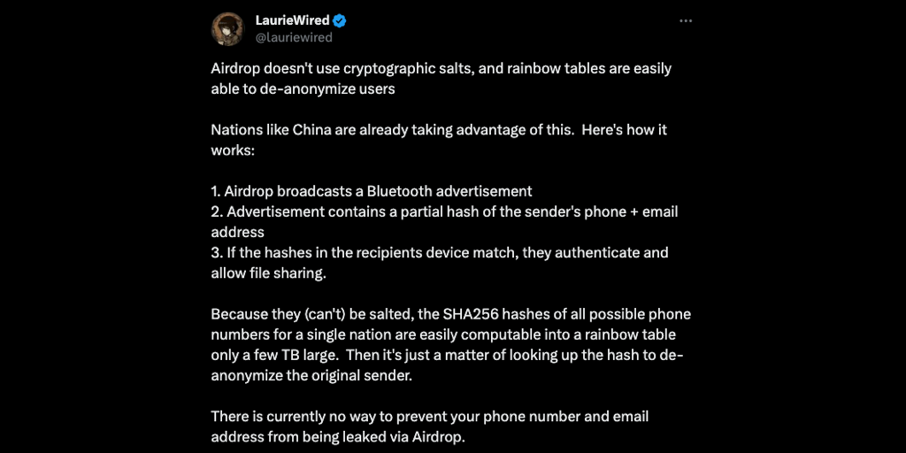
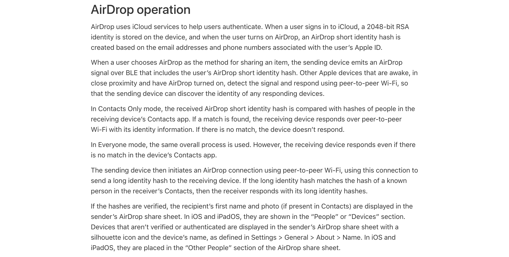
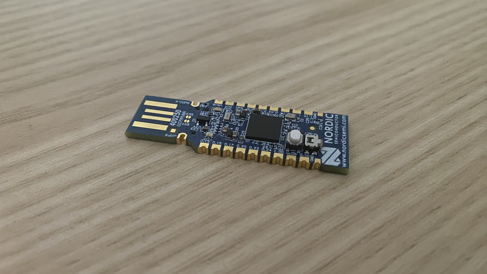
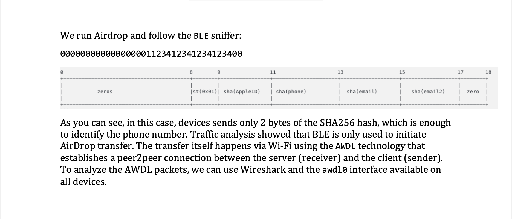
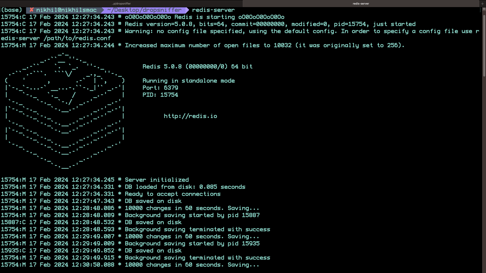
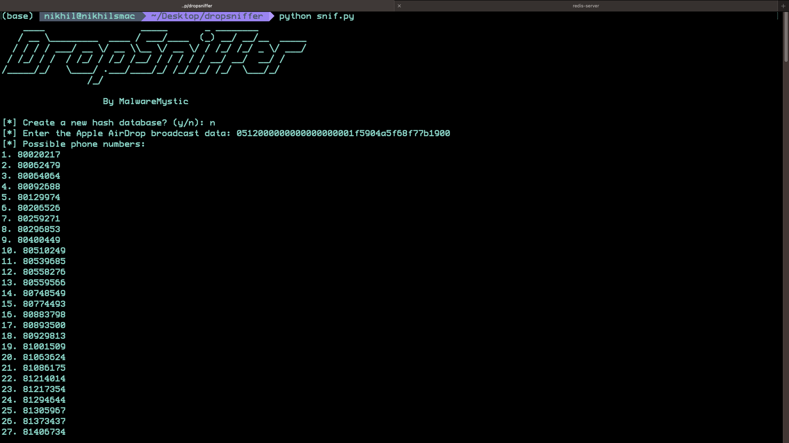

> Please exercise caution and respect privacy laws when attempting to obtain personal information through unconventional means; this content is for educational and demonstrative purposes only.

One afternoon, on my way to a university lecture that I looked forward to, I stopped to browse X. There, a post from LaurieWired caught my attention. LaurieWired is known for expertise in digital security, and the post warned that AirDrop's protocol omits cryptographic salts. This leaves it open to rainbow table attacks that could reveal a user's identity.

_@LaurieWired's tweet on X (formerly Twitter)_

LaurieWired explained that AirDrop sends a Bluetooth advertisement without strong cryptographic safeguards. The advertisement includes a partial hash of the sender's phone number and email address, so that a receiving device can recognize and authenticate the sender. Because the hash is not salted, an observer can precompute SHA256 hashes of phone numbers and store them in a rainbow table that takes up only a few terabytes. These tables can then help recover the original phone number or email address from the hash. LaurieWired added that no one currently knows how to fully prevent this leak, and that countries such as China might already be exploiting it.

The post made me want to understand how AirDrop handles our data and what we can do to protect our privacy. I decided to examine the weakness, its effects, and the ethics of privacy when technology develops faster than its safeguards.

## Researching AirDrop Security

When I returned home, I looked for authoritative information in Apple's official documentation. Its support pages described an AirDrop security protocol that seemed more complex and more secure than LaurieWired's account.

According to Apple, AirDrop uses iCloud services to authenticate users. When a user signs in, the device stores a 2048 bit RSA identity that secures its link to the iCloud account. This identity is the basis for an AirDrop short identity hash, which the device derives from the user's Apple ID email addresses and phone numbers.

_Apple's official description of AirDrop's secure file transfer process_

When a user starts an AirDrop transfer, the device broadcasts an encrypted Bluetooth Low Energy signal that contains the short identity hash. Nearby devices with AirDrop enabled detect the signal and start a private exchange over peer-to-peer Wi-Fi. In Contacts Only mode, the receiving device compares the hash with the hashes of its stored contacts, and it responds only if it finds a match.

In Everyone mode, the receiving device responds to all broadcasts, which makes sharing easier. After the first exchange, the devices connect over peer-to-peer Wi-Fi, and the sender then sends a long identity hash. By matching the long identity hashes, the devices confirm that the receiver is a known contact.

Apple describes several layers of protection, from RSA identities to short and long identity hashes. But LaurieWired's findings suggest that the lack of cryptographic salts may still leave AirDrop open to rainbow table attacks. I wanted to understand how this weakness fits with Apple's account.

## Sniffing Bluetooth Traffic

To observe AirDrop's behavior myself, I used a Nordic Semiconductor nRF52840 Dongle to capture Bluetooth traffic. Together with Wireshark, a widely used protocol analyzer, the dongle let me inspect nearby wireless signals.

_The Nordic Semiconductor nRF52840 Dongle_

After I configured the dongle and started Wireshark, I scanned for nearby Bluetooth activity, and soon I detected an AirDrop broadcast from an Apple device. Its BLE packets contained the short identity hash that LaurieWired had described.

_AirDrop's broadcast data as seen on Wireshark_

The hexadecimal string comes from an Apple user's email address and phone number, and devices use it to recognize one another securely. But the string was visible in the broadcast and easy to capture. Anyone nearby with the equipment and technical skills could get these short identity hashes.

If rainbow table techniques can reverse these hashes, as LaurieWired suggested, they may expose personal information more easily than users expect.

## Decoding the AirDrop Broadcast Data

My capture contained a 30 character hexadecimal string, and I wanted to find the part that held the partial hash. While I searched for information, I found a guide from the team at Hexway that described the weakness in detail.

_Hexway's guide on the AirDrop broadcast data_

Hexway explained that AirDrop devices send only two bytes of the SHA256 hash of the user's Apple ID, phone number and email address. But my capture had a different structure from the examples in the guide. It began with the preamble 0512 and seventeen zeros, followed by a sequence that matched Hexway's format. The partial hash also sat at the end of the string, in its last four characters. Those four characters match the two-byte length, but the guide placed the hash at positions 11 to 13.

I wrote a Python script to generate partial SHA256 hashes for all phone numbers in Singapore. The country's standardized numbering system made the full range practical to compute, and the computation took about thirty-five minutes.

_The Redis database of partial hashes and phone numbers_

I stored the hash and phone number pairs in Redis, a fast, in-memory key-value data store. Its fast reads and writes, and its simple key-value structure, suited the quick lookups I needed to find possible matches. Redis also supports persistence, so the data survives restarts.

_A list of all possible phone numbers_

A two-byte hash fragment has collisions, because many phone numbers share the same truncated hash. When I checked the broadcast data against the Redis database, nearly one hundred phone numbers matched. The fragment therefore did not identify a unique number, which, as I expected, showed the limit of truncated hashes for security.

Information about active phone number ranges and targeted OSINT techniques could narrow the list further. AirDrop makes file sharing convenient, but this experiment shows how parts of its design may expose users to unexpected privacy risks. Users need to understand these risks, and they need to use AirDrop with care.
